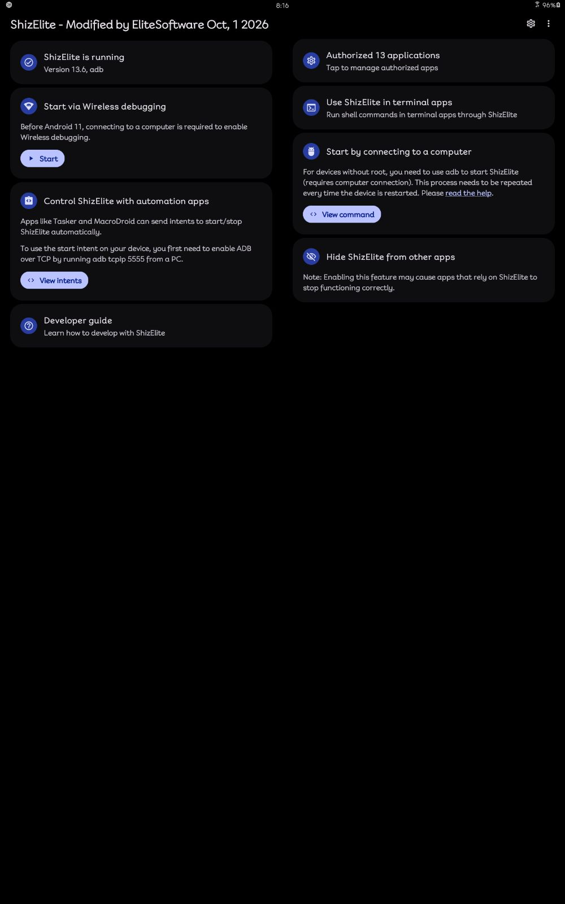
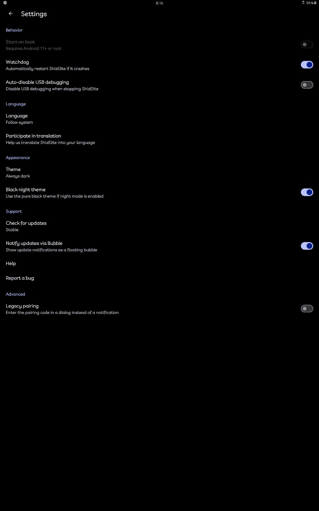
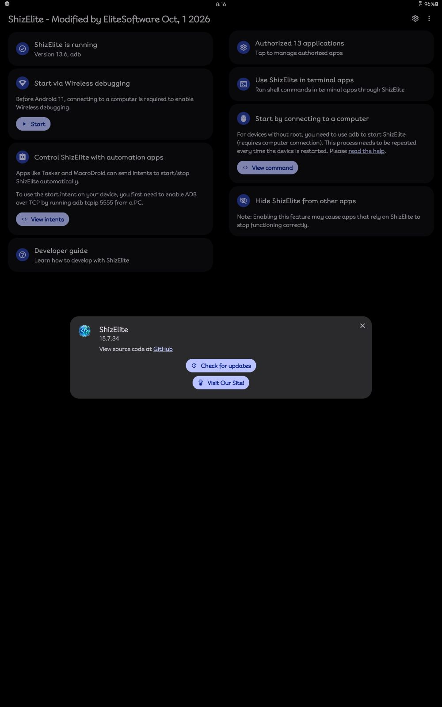
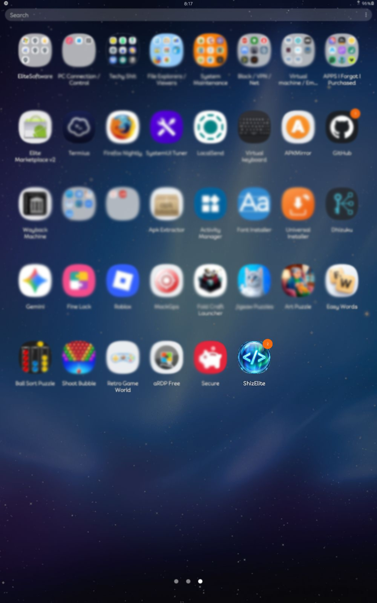
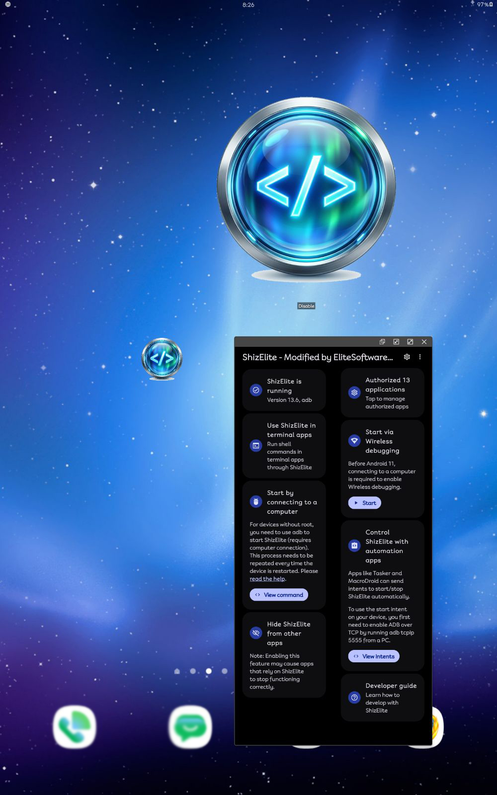
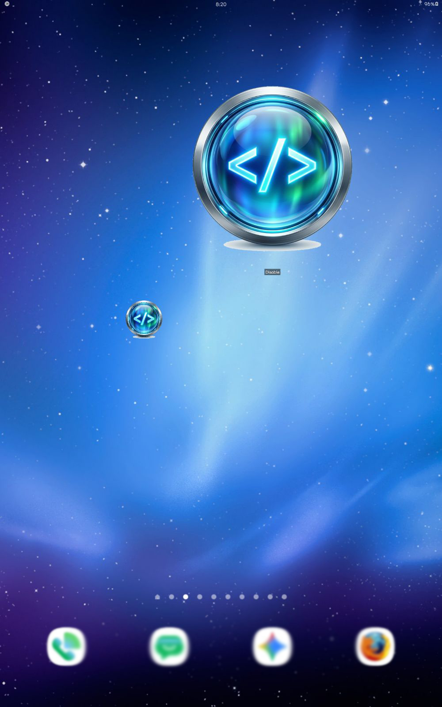
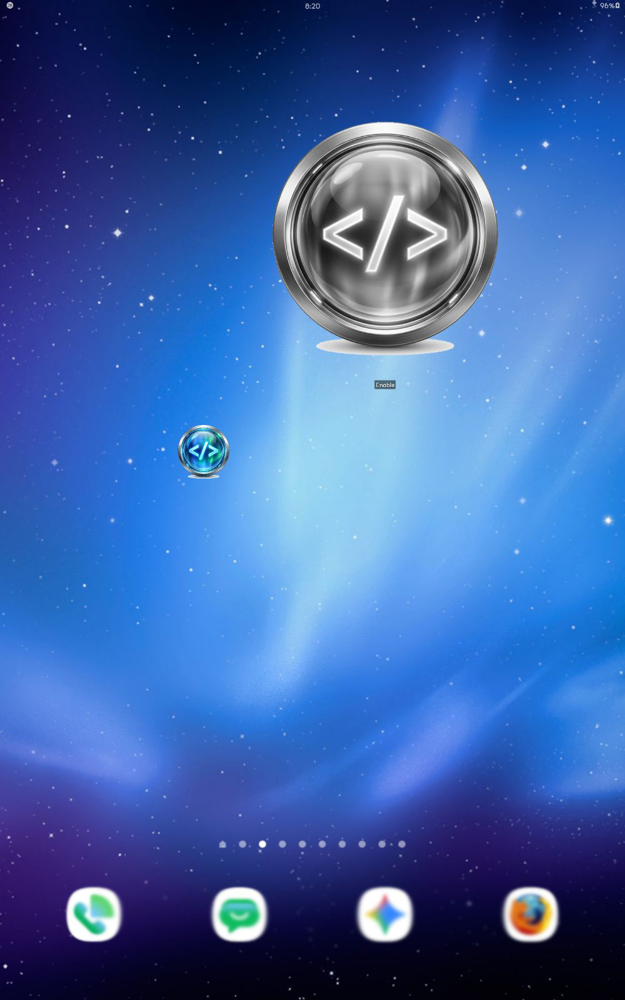
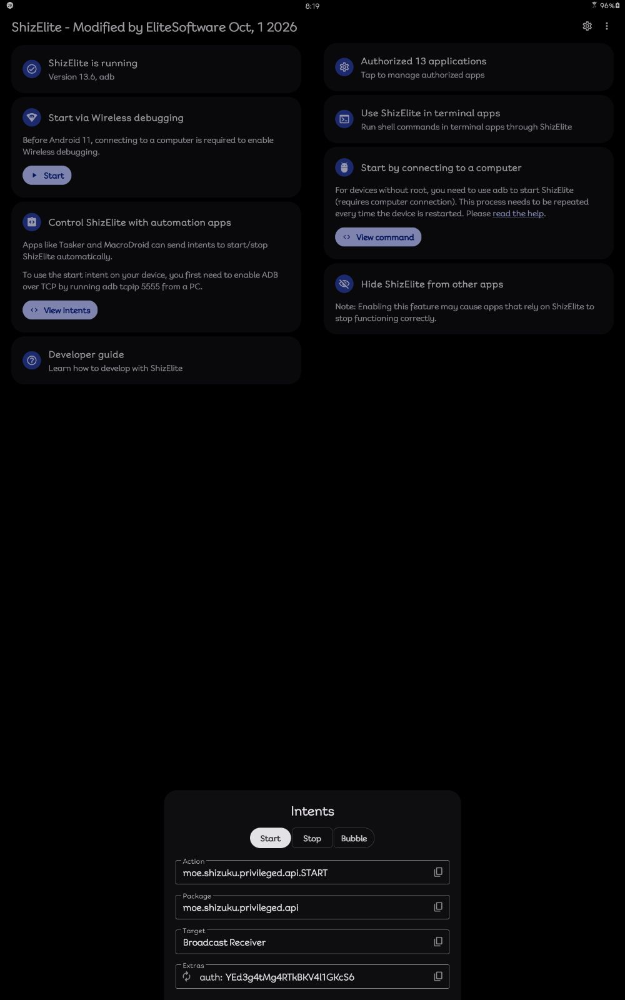
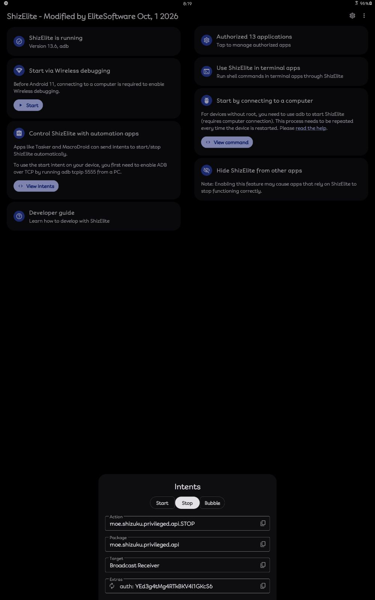
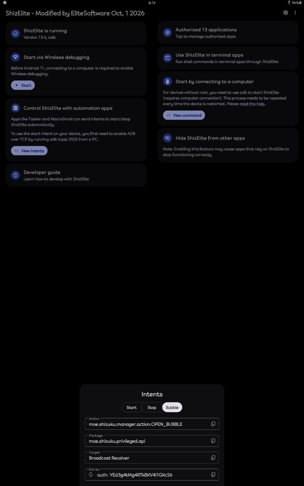

# Some Screenshots on Various Devices

## Number 1 -- Android 10 (Galaxy Tab S4):

### Main App Page

### App Settings

### About Popup

### App Drawer Icon

### Popup View With Widgets

### Enabled Widget

### Disabled Widget

### Start Intent

### Stop Intent

### Bubble Intent (Android 11+)

